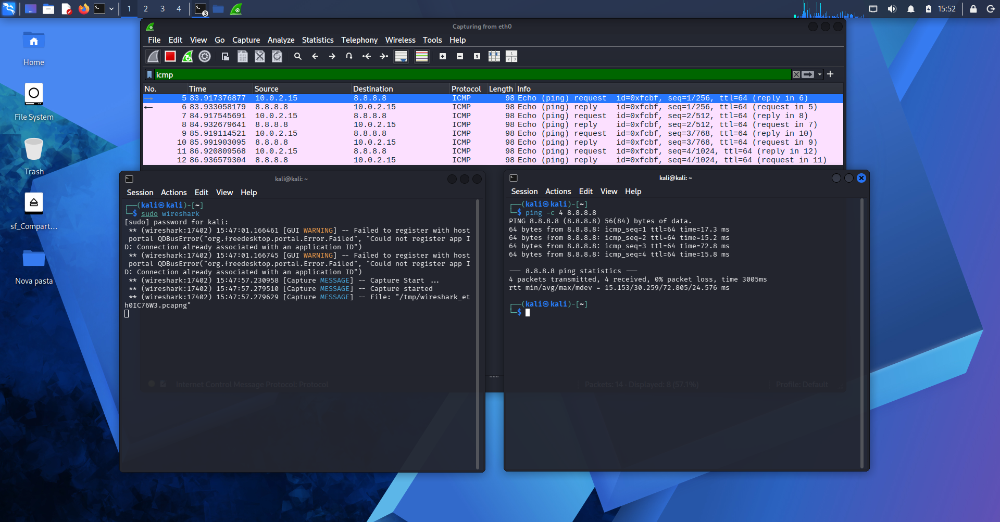
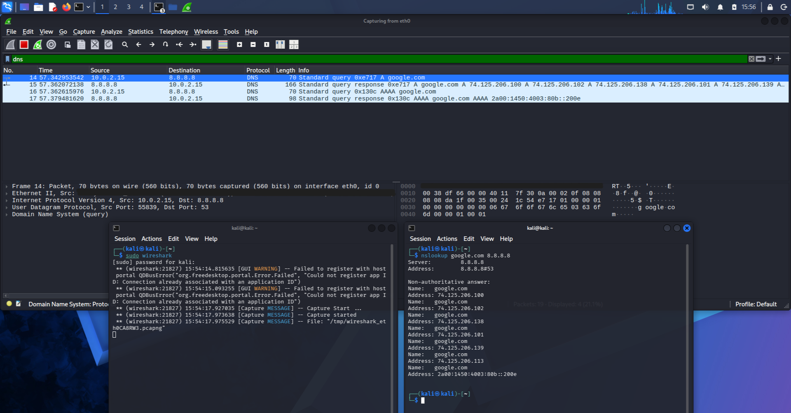
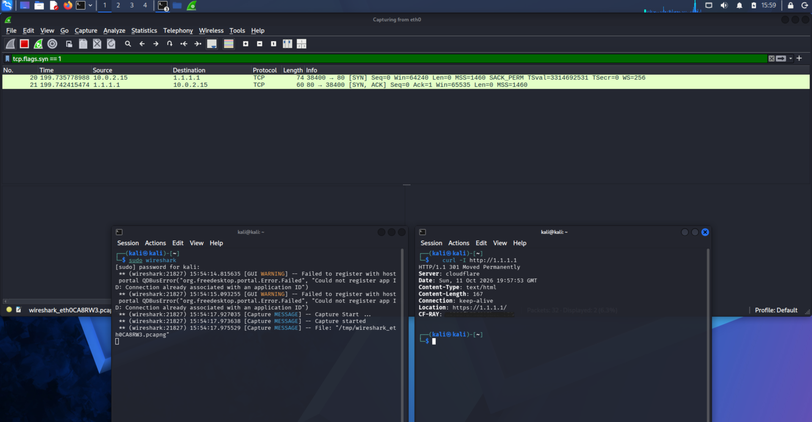
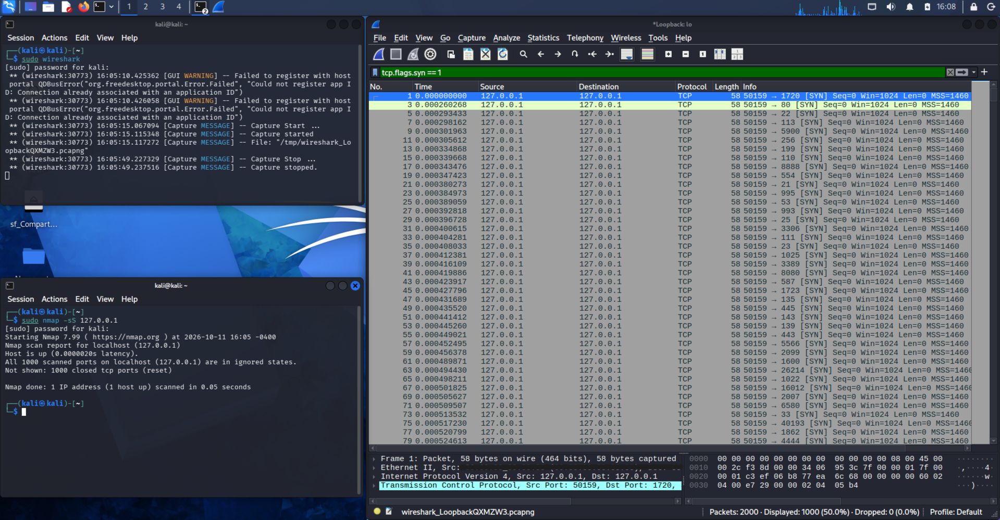
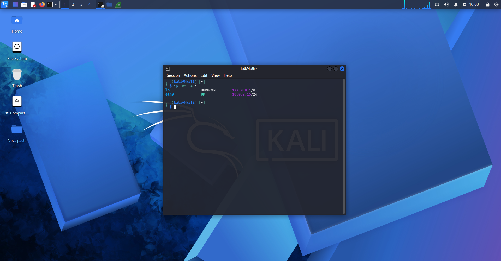

# 01 - Wireshark basics

My first lab. I captured my own traffic on a Kali VM (NAT) to see how ICMP, DNS and the TCP handshake look on the wire, and what an Nmap scan looks like.

---
# How to repeat it
Start the capture first, then run the command. Otherwise you miss the traffic.

```
ping -c 4 8.8.8.8                  # filter: icmp
nslookup google.com 8.8.8.8        # filter: dns
curl -I http://1.1.1.1             # filter: tcp.flags.syn == 1
sudo nmap -sS [target]             # filter: tcp.flags.syn == 1 (capture on lo if the target is 127.0.0.1)
ip -br -4 a                        # VM interface and IP
```

Only scan machines you own.

---
# What I saw

## ICMP (ping)
4 echo requests and 4 echo replies, 0% packet loss. Round trip was between 15 and 73 ms (average 30 ms), the 3rd ping was the slow one. Every packet has the same `id` and the `seq` goes from 1 to 4, that's how Wireshark matches each reply to its request. Each packet is 98 bytes.



## DNS
I asked 8.8.8.8 directly with nslookup. The VM sends two questions, A (IPv4) and AAAA (IPv6), over UDP port 53. google.com came back with 6 IPv4 addresses and 1 IPv6. Each answer has the same transaction ID as its question (0xe717 and 0x130c), that's how they get paired. Answers took about 20 ms.



## TCP handshake
Filtering by SYN shows the first two steps of the 3-way handshake: my VM (random high port 38400) sends a SYN to 1.1.1.1 port 80 and the server answers with SYN/ACK. The last step (ACK) doesn't show up because it has no SYN flag. curl got a 301 redirect to HTTPS.



## Nmap scan
`sudo nmap -sS 127.0.0.1` on my own VM, captured on the loopback (lo) interface. Nmap checked 1000 ports in 0.05 seconds and reported all of them closed (reset). In Wireshark that's 2000 packets: 1000 SYN, all from the same source port (50159) going to a different destination port each time, and 1000 replies hidden by the filter. A closed port answers with a reset, an open one would answer SYN/ACK. A burst of SYNs to many ports like this is what a scan looks like.



## Host info
`ip -br -4 a` shows the VM on eth0 with IP 10.0.2.15/24, plus the loopback (127.0.0.1).



---
# Privacy notes

Home network, so I kept it clean: only public targets (8.8.8.8 and 1.1.1.1) and my own VM, DNS sent straight to 8.8.8.8 instead of my router, MAC addresses hidden or covered in the screenshots, and no .pcap files uploaded.

---
# What I learned

Seeing the handshake and the DNS question/answer with my own eyes made TCP/IP click. I also saw how loud a port scan is: 1000 SYN packets in a fraction of a second.
