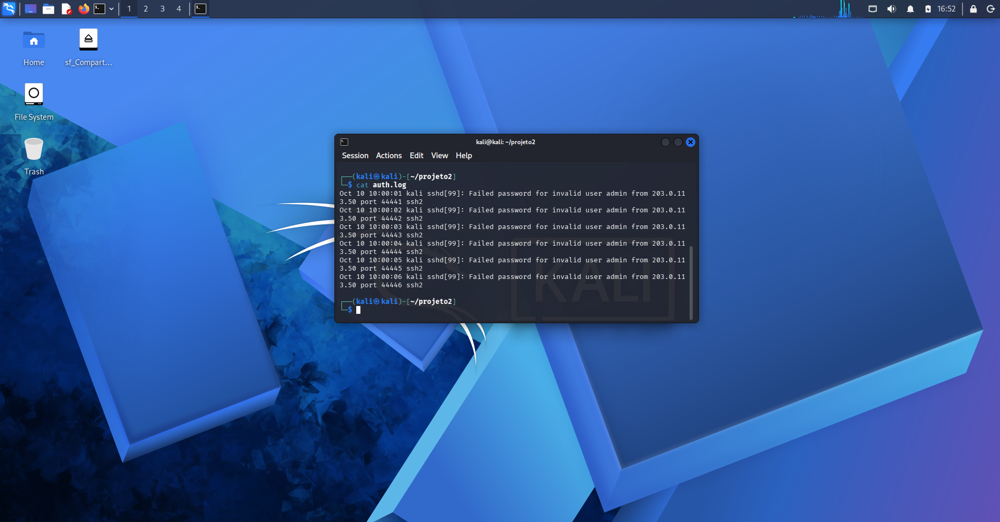
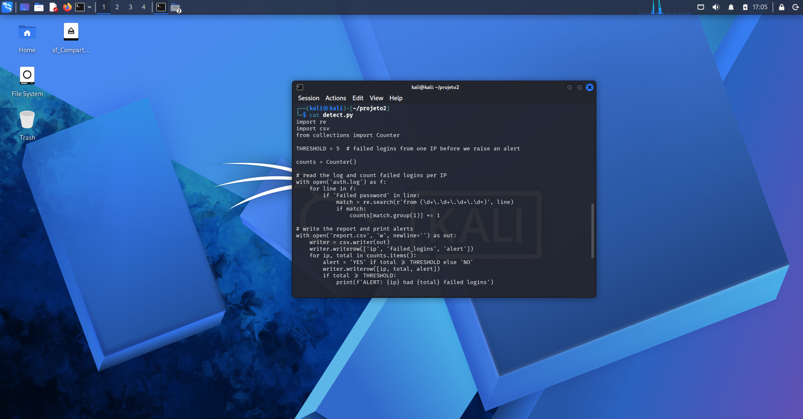
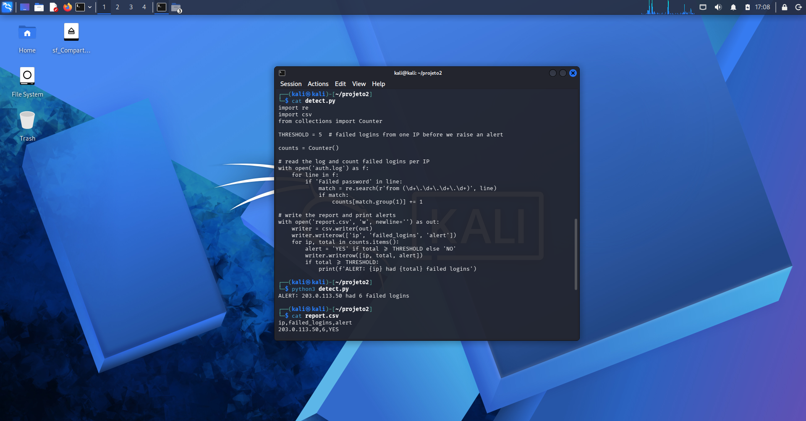
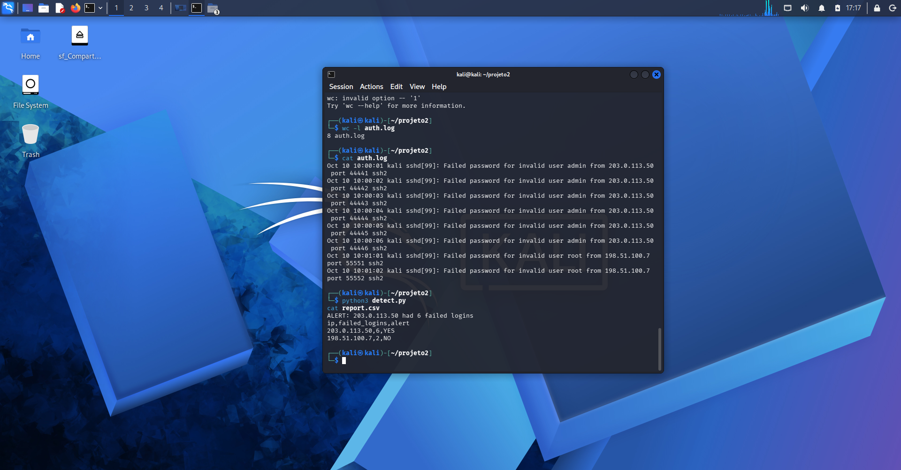
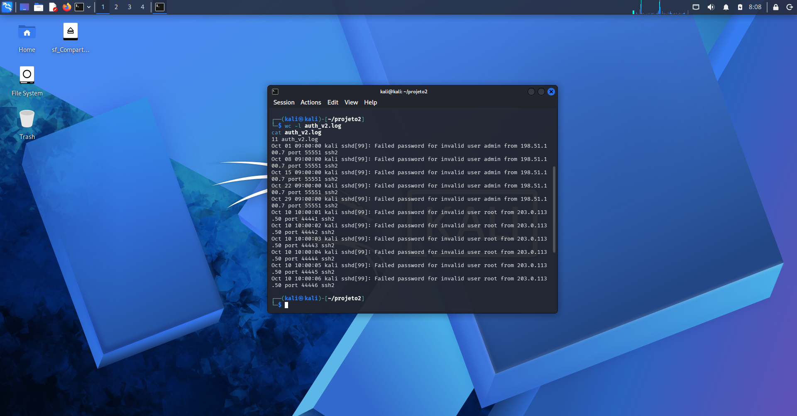
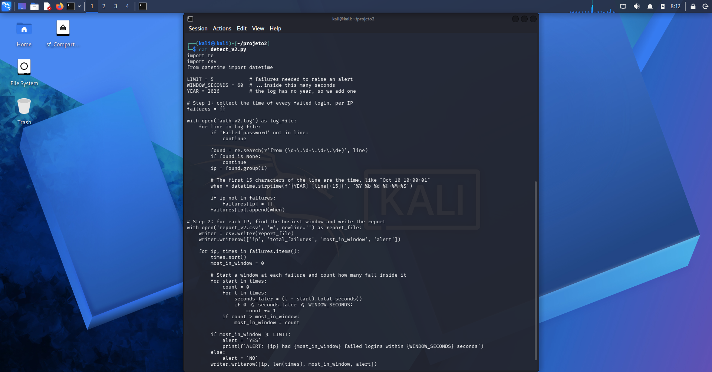
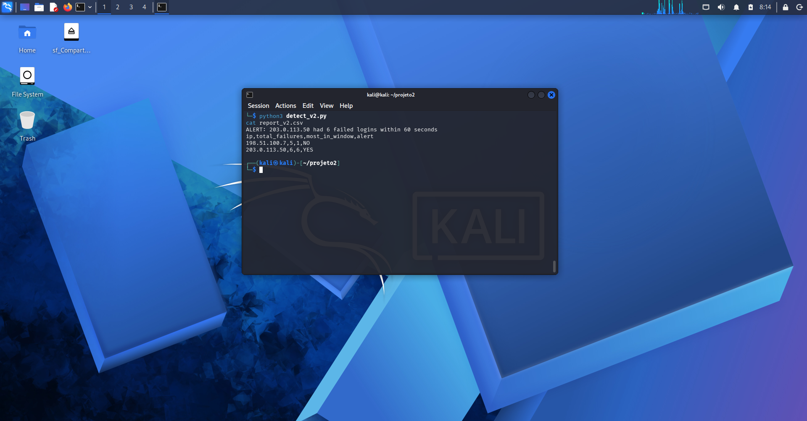

# 02 - Brute force detector (Python)

My second lab. I wrote a small Python script that reads a login log, counts how many times each IP got the password wrong, and raises an alert when one IP fails too many times. It's a basic detection rule, the kind of thing a SOC runs all the time.

---

# Notes

- The log is fake. I created it myself with a shell loop, it doesn't come from a real system.
- The IPs in it (203.0.113.50 and 198.51.100.7) are from ranges reserved for examples, so they don't belong to anyone.
- `report.csv` was generated by my script from that fake log, so there's no real data in it.

---

# How to repeat it

First, create the test log. Run this once, because `>>` adds to the end of the file:

```
for i in 1 2 3 4 5 6; do echo 'Oct 10 10:00:0'$i' kali sshd[99]: Failed password for invalid user admin from 203.0.113.50 port 4444'$i' ssh2' >> auth.log; done
for i in 1 2; do echo 'Oct 10 10:01:0'$i' kali sshd[99]: Failed password for invalid user root from 198.51.100.7 port 5555'$i' ssh2' >> auth.log; done
```

Then run the script and look at the report:

```
python3 detect.py
cat report.csv
```

---

# What I did

## 1. Made the log
Six failed logins from one IP, so I had something to catch.



## 2. Wrote the script
I kept it short on purpose, so I could understand every line.



## 3. First run
The limit was 5 and that IP failed 6 times, so I got an alert. The script also made `report.csv` with one line per IP.



## 4. Added a second IP
This one only failed twice. It stayed under the limit, so no alert for it. That's the whole idea: separate the noise from the suspicious stuff.



## 5. Played with the limit
I dropped it to 2 and the second IP got flagged too. A low limit catches more, but it also flags someone who just typed the password wrong twice. A high limit is quieter, but it can miss a slow attack. I put it back to 5.


---

# How the script works

1. Opens `auth.log` and reads it line by line.
2. Ignores everything that isn't a `Failed password` line.
3. Grabs the IP that comes after the word `from` (using a regex).
4. Counts the failures for each IP with `Counter`.
5. Writes `report.csv` and prints an alert for every IP at or above the limit.

---

# Things that went wrong

- `cat auth.log` said "No such file or directory". I was in my home folder, not in the project folder. `pwd` and `ls` showed me, and `cd projeto2` fixed it.
- `report.csv` still showed only one IP after I added the second. The report only updates when the script runs, so I had to run `python3 detect.py` again.

---

# What I learned

A log is just text, and with a few lines of Python you can turn it into numbers. I also saw how much the limit decides what gets flagged. This was my first time writing a detection rule, even a tiny one.

---

# Update: fixing a flaw (version 2)

After I understood how the script works, I noticed a flaw in my detection logic. It counts the failures of the whole file, so 5 failed logins spread over a month trigger the same alert as 5 failed logins in one minute. The first is probably someone who forgot their password, the second looks like an automated attack.

I kept `detect.py` as it was and wrote `detect_v2.py`, which counts failures inside a time window: 5 failures in 60 seconds.

## Notes

- `auth_v2.log` is another fake log I generated myself. The IPs are again from ranges reserved for examples, so they don't belong to anyone.
- The log lines have no year, so I set it in the script (`YEAR = 2026`).

## How to repeat it

Create the second log. Run each command once:

```
for day in 01 08 15 22 29; do echo "Oct $day 09:00:00 kali sshd[99]: Failed password for invalid user admin from 198.51.100.7 port 55551 ssh2" >> auth_v2.log; done
for i in 1 2 3 4 5 6; do echo "Oct 10 10:00:0$i kali sshd[99]: Failed password for invalid user root from 203.0.113.50 port 4444$i ssh2" >> auth_v2.log; done
```

Then run version 2:

```
python3 detect_v2.py
cat report_v2.csv
```

## What I did

### The new log
Two IPs: one with 5 failures spread over the month, and one with 6 failures in a few seconds.



### The new script
Instead of only counting, it saves the time of every failure and, for each IP, looks for the busiest 60 seconds.



### The result
Version 1 would have flagged both IPs, because both have 5 or more failures in total. Version 2 only flags the one with 6 failures in a few seconds. The one spread over the month stays quiet.



## What I learned

Counting is not enough, time matters too. The log already had the timestamps and I wasn't using them. This is still simple: it works for a small fake log, and a real one would need a faster way to count.
