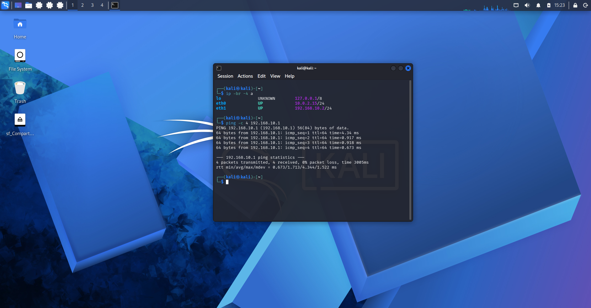
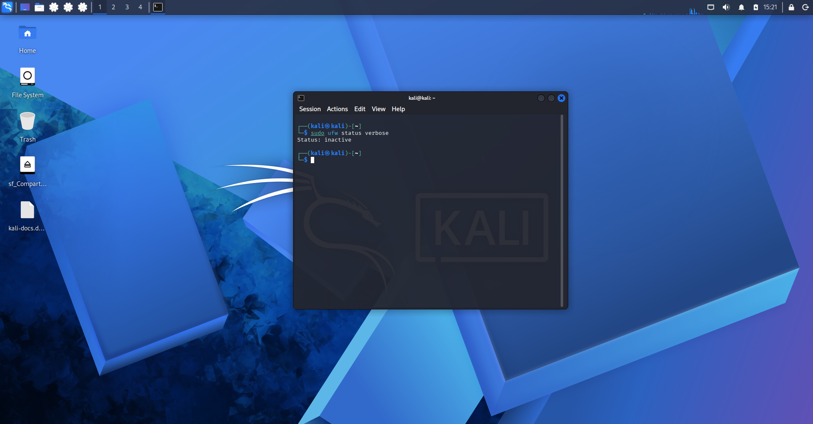
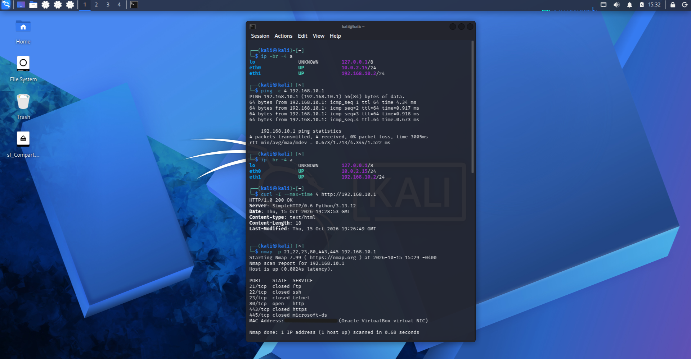
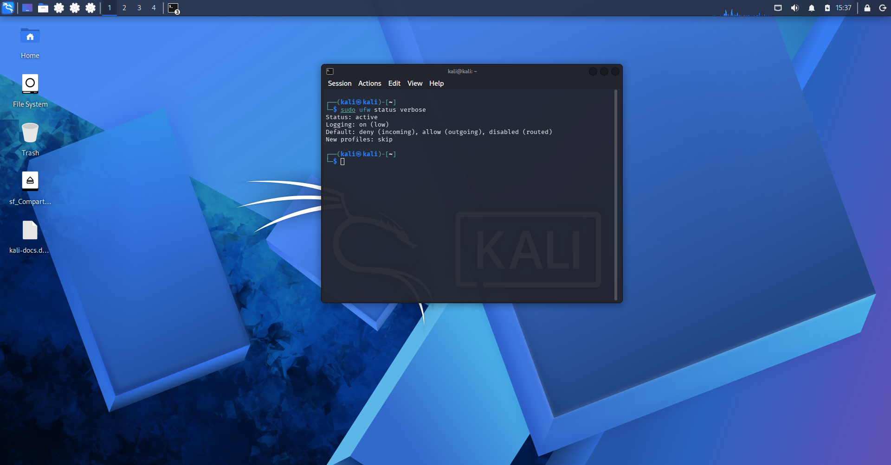
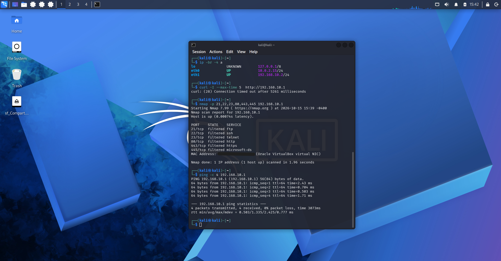
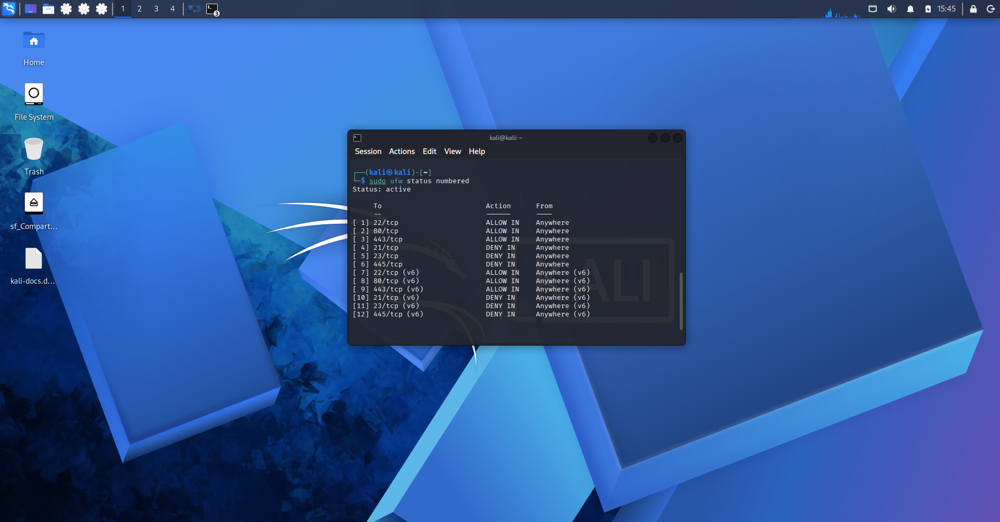
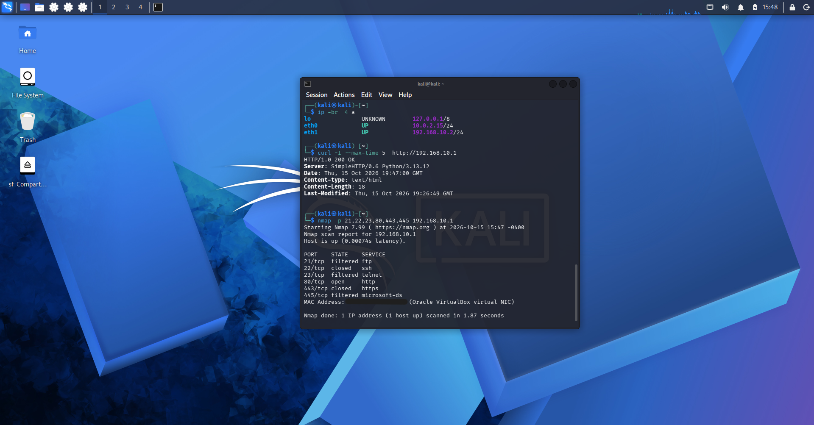
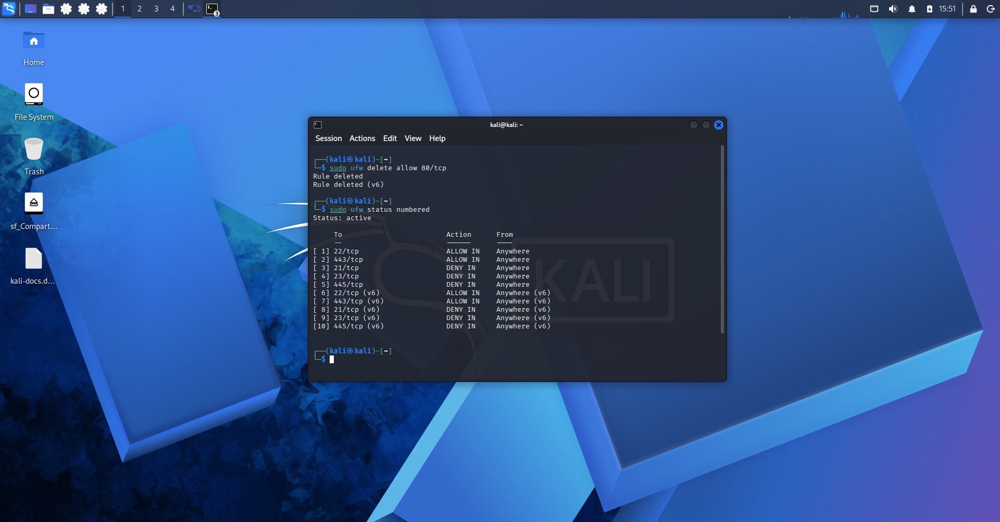
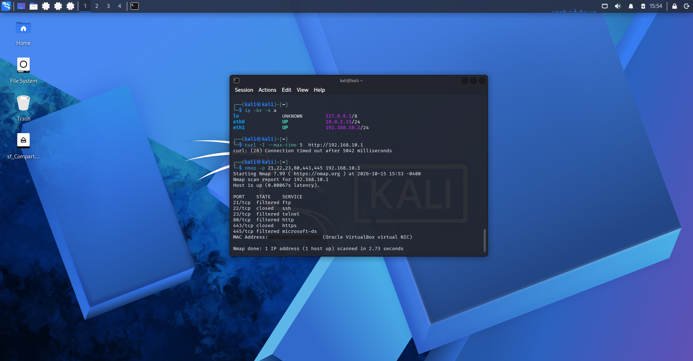

# 03 - Linux firewall with UFW

My third lab. I set up the UFW firewall on a Kali VM with the rules I learned in my course, then used a second VM to test that the rules really work. The goal was to watch a port go from open, to blocked, and back.

---

# Setup

- Two Kali VMs in VirtualBox: a server and a client.
- Each one has two network cards: NAT for internet, and an internal network just for the two VMs, with no connection to my home network.
- Fixed IPs on the internal network: server `192.168.10.1`, client `192.168.10.2`.
- A tiny web server on port 80 of the server (`python3 -m http.server`).
- All the tests run from the client with `ping`, `curl` and `nmap`.

---

# Notes

- Both VMs are clones of the same Kali VM, each one with its own MAC address.
- Everything stays inside my own VMs, nothing touches my home network.
- The screenshots only show lab IPs, and no MAC addresses.
- The rules are the ones from my course, written and tested by me in this lab.

---

# How to repeat it

On the server:

```
sudo apt install ufw
mkdir ~/web-test && cd ~/web-test
echo "lab firewall test" > index.html
sudo python3 -m http.server 80 --bind 192.168.10.1
```

Keep that terminal open, and use a second one for the firewall:

```
sudo ufw default deny incoming
sudo ufw default allow outgoing
sudo ufw enable
sudo ufw allow 22/tcp
sudo ufw allow 80/tcp
sudo ufw allow 443/tcp
sudo ufw deny 21/tcp
sudo ufw deny 23/tcp
sudo ufw deny 445/tcp
sudo ufw status numbered
```

On the client, test after each step:

```
curl -I --max-time 5 http://192.168.10.1
nmap -p 21,22,23,80,443,445 192.168.10.1
```

---

# What I did

## 1. Checked the connection first
The client pings the server before any firewall is on, so I know the network works.



## 2. Installed UFW
It comes off by default.



## 3. Tested with no firewall
`curl` gets a `200 OK` and `nmap` shows port 80 open. This is my baseline.



## 4. Turned the firewall on, blocking everything coming in
`deny incoming` and `allow outgoing`, with no other rules.



## 5. Tested again
The web server was still running, but now `curl` waits 5 seconds and times out, and `nmap` shows the ports as `filtered`. The ping still answered (0% packet loss), because UFW lets ping through by default.



## 6. Added the rules from my course
Allowed 22, 80 and 443, and denied 21, 23 and 445.



## 7. Tested the rules
`curl` works again. This is the part I liked most, because `nmap` shows three different states at the same time:

| Port | What nmap showed | Why |
|---|---|---|
| 80 | open | Allowed, and the web server is listening |
| 22 | closed | Allowed, but nothing is listening on it |
| 443 | closed | Allowed, but nothing is listening on it |
| 21, 23, 445 | filtered | Blocked, the firewall drops the packets |



## 8. Deleted the rule for port 80
`sudo ufw delete allow 80/tcp`



## 9. Tested one more time
The web server was still running, but the port was `filtered` again and `curl` timed out. So the firewall is what decides, not the service.



---

# Things that went wrong

- My first try mixed up the results. The web server had stopped, so `curl` failed in 2 ms. That is what a closed port looks like, not a firewall. I redid the lab from scratch with the web server in its own terminal.
- One ping gave me 0.03 ms and looked perfect, but I had pinged the server from the server itself. I threw it away and pinged from the client.
- The cloned VMs came with the NAT card disconnected, and the internal card kept asking for an IP by DHCP on a network with no DHCP server. My IPs and routes disappeared.
- The default `Wired connection 1` profile is not tied to a network card, so it follows whichever card activates it. My lab IP ended up on the NAT card. I fixed it by creating a profile tied to `eth1`.
- The server also had an old fixed IP for `eth1` in `/etc/network/interfaces`, so the two VMs were on different networks. I fixed it by moving the client to the same network.
- I typed `ping 2 8.8.8.8` instead of `ping -c 2 8.8.8.8`, and it failed even with the network fine.

---

# What I learned

- `closed` and `filtered` are not the same thing. Closed means the packet got there and nothing was listening. Filtered means the firewall dropped it.
- A firewall that blocks everything by default, and opens only what is needed, is easier to trust than one that tries to block bad things one by one.
- The `deny` rules for 21, 23 and 445 are redundant when everything is blocked by default, but they make my intention clear and still work if the default changes.
- Always test the rules from another machine. Reading the rule list is not proof that it works.
