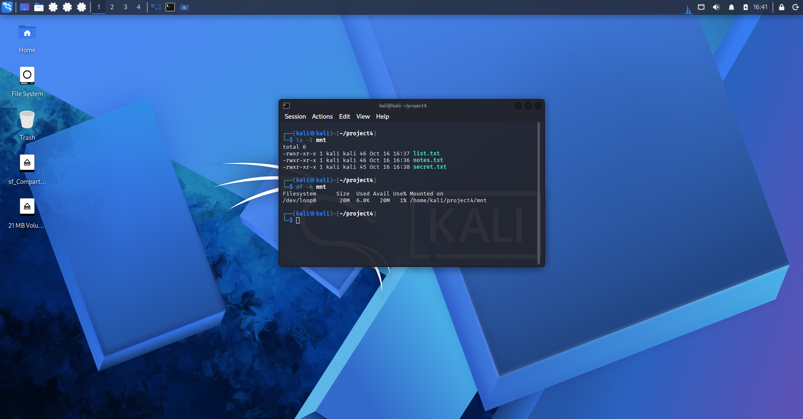
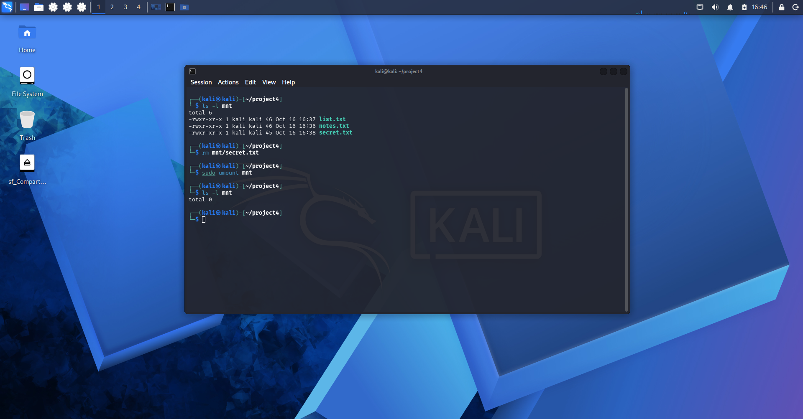
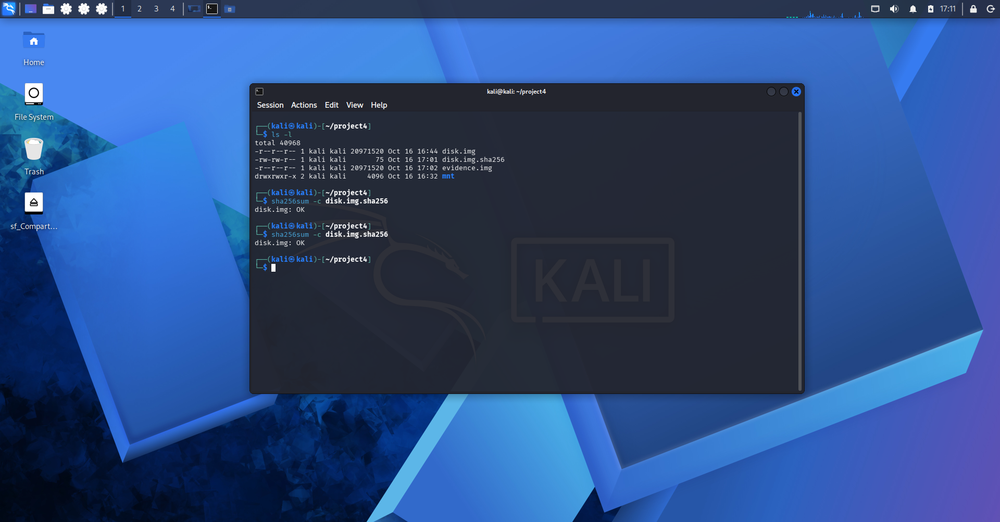
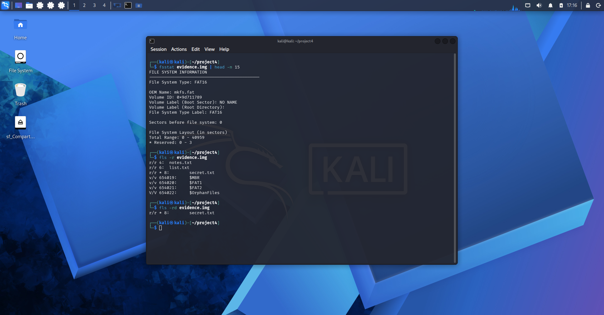
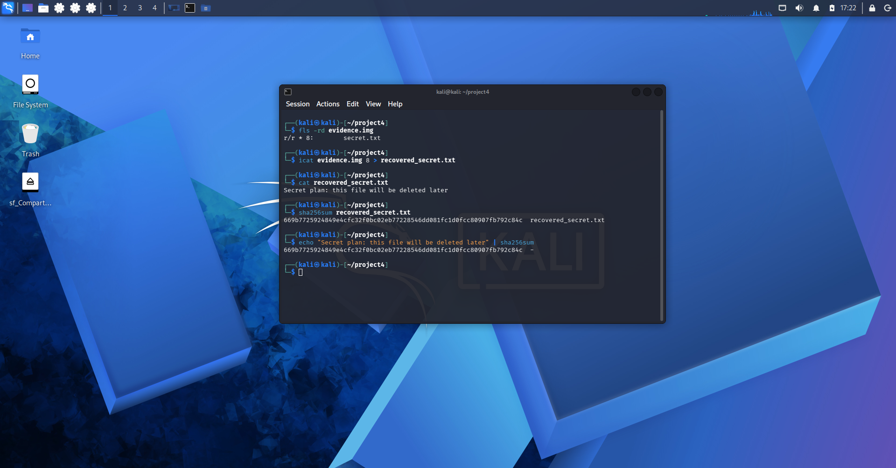
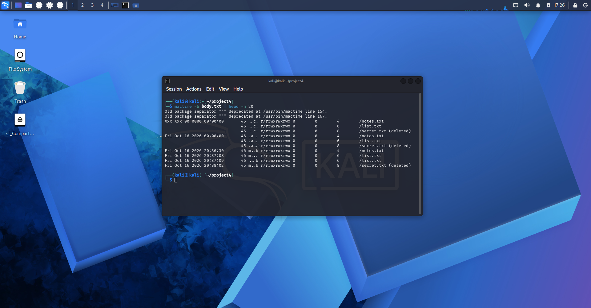

# 04 - Digital forensics basics

My fourth lab. I built a small fake disk image, deleted a file from it, and then analyzed the image like an investigator would: hash it, work on a copy, list the files (including the deleted one), recover it, check that the recovery is exact and build a timeline.

---

# Notes

- The disk image and every file inside it are fake. I created them myself, there is no real data.
- I am not uploading the disk images (`disk.img` and `evidence.img`), only the screenshots and two small text files.
- Everything ran inside my own Kali VM.
- The lab folder has three files on purpose: `disk.img` is the original image and stays read-only, `disk.img.sha256` is a text file with the hash of the original so I can check it later, and `evidence.img` is the working copy I analyze. The `mnt` folder is the empty mount point.

---

# How to repeat it

Install the tools:

```
sudo apt install sleuthkit dosfstools
mkdir ~/project4 && cd ~/project4
```

Create the disk and the fake files:

```
dd if=/dev/zero of=disk.img bs=1M count=20
mkfs.vfat -F 16 disk.img
mkdir mnt
sudo mount -o loop,uid=$(id -u),gid=$(id -g) disk.img mnt
echo "Meeting notes: fake data for my forensics lab" > mnt/notes.txt
echo "Shopping list: fake file for my forensics lab" > mnt/list.txt
echo "Secret plan: this file will be deleted later" > mnt/secret.txt
```

Delete one file and unmount:

```
rm mnt/secret.txt
sudo umount mnt
```

Hash the original, make it read-only and copy it:

```
sha256sum disk.img | tee disk.img.sha256
chmod 444 disk.img
cp disk.img evidence.img
sha256sum -c disk.img.sha256
sha256sum disk.img evidence.img
```

Analyze the copy:

```
fsstat evidence.img | head -n 15
fls -r evidence.img
fls -rd evidence.img
icat evidence.img N > recovered_secret.txt
fls -m / -r evidence.img > body.txt
mactime -b body.txt | head -n 20
```

`N` is the number of the deleted file in the `fls -rd` line (the number before the colon).

---

# What I did

## 1. Made the disk and the files
A 20 MB disk image formatted as FAT16, mounted on a folder, with three fake files.



## 2. Deleted a file and unmounted
I deleted `secret.txt`, then unmounted the disk. After the unmount the `mnt` folder is empty again, because the files live inside the image, not in the folder.



## 3. Hashed the original and made a copy
I saved the SHA-256 hash of the original, made it read-only and worked on a copy. The check says `disk.img: OK` and both hashes match, so the copy is exact.



## 4. Listed the files, deleted ones too
`fls` shows the two normal files and the deleted one, which is marked with an asterisk. A deleted file on FAT only gets marked as deleted, its data stays on the disk.



## 5. Recovered the file and checked it
`icat` pulled the content of the deleted file by its number. The hash of the recovered file matches the hash of the original text, so the recovery is exact.



## 6. Built a timeline
`fls -m` and `mactime` turn the image into a timeline. The three files were created seconds apart and the deleted one is marked.



---

# Things that went wrong

- `cp` said "Permission denied" on the original image. My `chmod` had left it with mode `---r--r--` instead of `-r--r--r--`, so the owner (me) had no read permission, and Linux checks the owner first. I ran `cp` with `sudo`, which hid the cause and left a copy owned by root. I fixed it with `chmod 444`, deleted the bad copy, copied again without `sudo` and redid both hashes.

---

# What I learned

- In Linux a disk (or a disk image) is attached to a folder, called a mount point. Everything I write in that folder goes into the image. I named it `mnt` by convention (it comes from "mount"), but the name is free. I have to unmount before analyzing, so everything is really written to the file.
- Deleting a file on a FAT disk only marks it as deleted. The data stays until something overwrites it, and that is why I could recover it.
- Always hash the evidence first and work on a copy, so I can prove the original did not change.
- Linux checks permissions in order: owner, then group, then others, and uses the first one that applies. Using `sudo` to get past an error can hide the real problem.
- The recovery worked here because I wrote nothing to the disk after deleting the file. On a disk in use, the space can be reused and the file can be lost, partly or completely.
